# LiDARDustSim

**A Physics-Prior-Guided Framework for LiDAR Dust Point Cloud Generation**

## Abstract

Vehicle-induced dust introduces non-target returns into LiDAR point clouds, degrading perception. Collecting real dust data at scale is difficult because dust varies with vehicle motion, road conditions, particle size, and wind. This paper presents LiDARDustSim, a physics-prior-guided framework for LiDAR dust point-cloud generation. First, CFD-DPM simulates vehicle-wake flow and particle transport to produce a spatially non-uniform dust concentration field. A LiDAR physical model then simulates laser propagation, attenuation, scattering, and echo response to generate physically constrained dust geometry. Propagation distance, local geometric descriptor, and observation angle are calculated from the generated geometry and used to condition a denoising diffusion probabilistic model (DDPM) for learning reflectance-intensity distributions from real dust data. Generated intensities are mapped onto the simulated points to form the final point cloud. Experiments on the public LiDARDustX dataset across six LiDAR sensors show the smallest discrepancies in FPD, FRD, JSD, and MMD, indicating high distributional consistency with real dust. Qualitative comparisons and downstream 3D object detection further demonstrate realistic dust characteristics and augmentation benefits on most sensors.

## Generation Results

Examples of dust point clouds generated by LiDARDustSim across six LiDAR sensors. Colors indicate reflectance intensity.

<table>
  <tr>
    <th align="center" width="33%">CB64S1</th>
    <th align="center" width="33%">LS128S2</th>
    <th align="center" width="33%">Falcon K1</th>
  </tr>
  <tr>
    <td align="center"><a href="assets/ls64_intensity_white.png">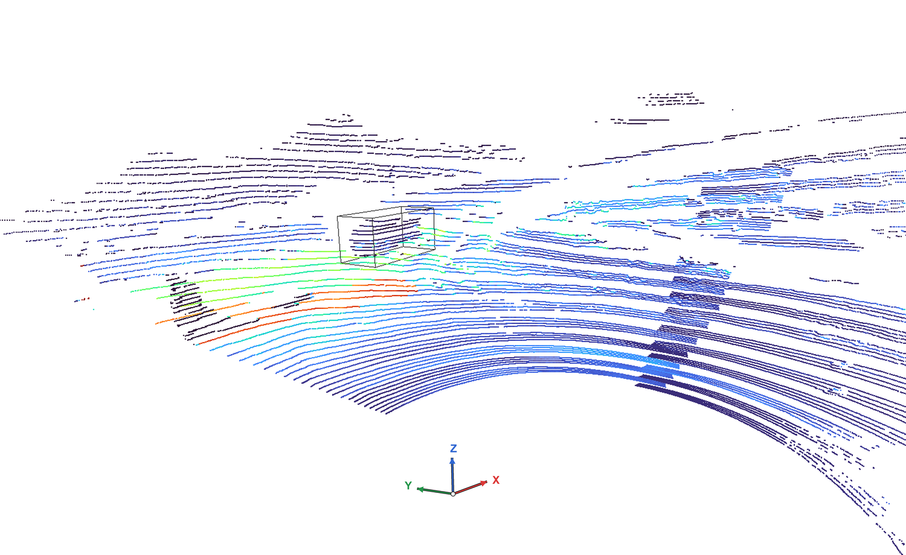</a></td>
    <td align="center"><a href="assets/ls128_intensity_white.png">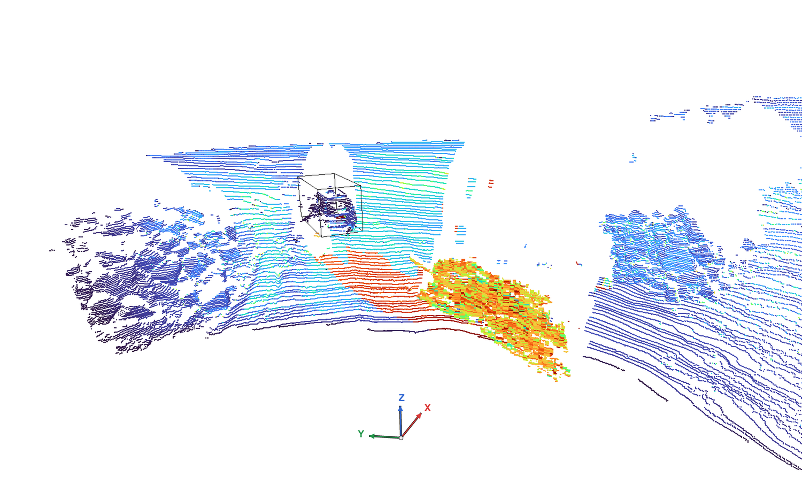</a></td>
    <td align="center"><a href="assets/ly150_intensity_white.png">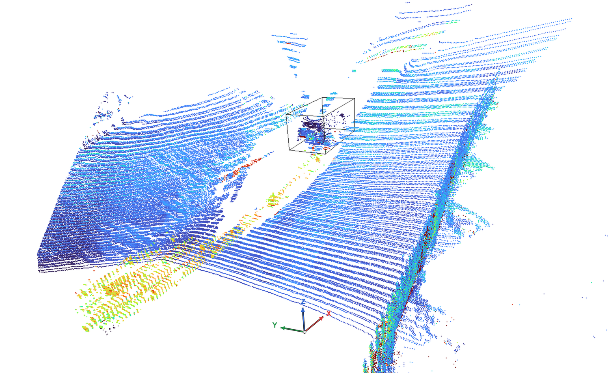</a></td>
  </tr>
  <tr>
    <th align="center" width="33%">Falcon K3</th>
    <th align="center" width="33%">M1</th>
    <th align="center" width="33%">Ouster 2</th>
  </tr>
  <tr>
    <td align="center"><a href="assets/ly300_intensity_white.png">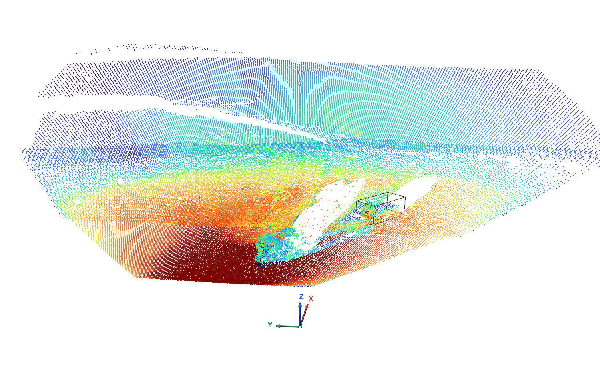</a></td>
    <td align="center"><a href="assets/m1_intensity_white.png">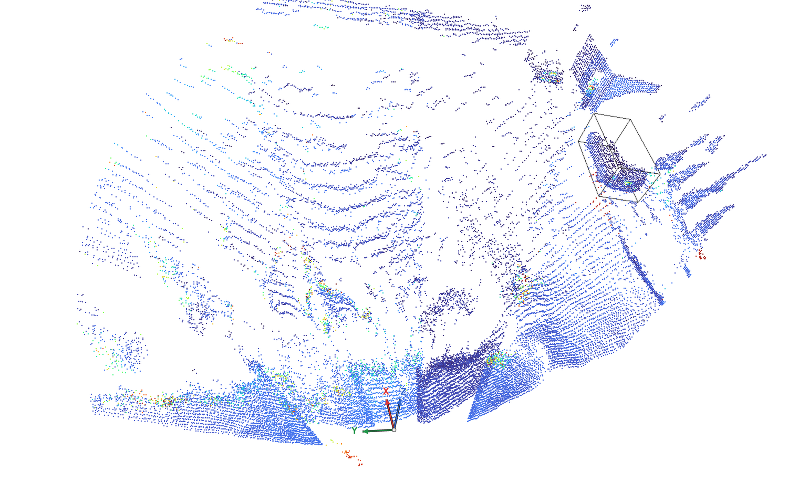</a></td>
    <td align="center"><a href="assets/ouster_intensity_white.png">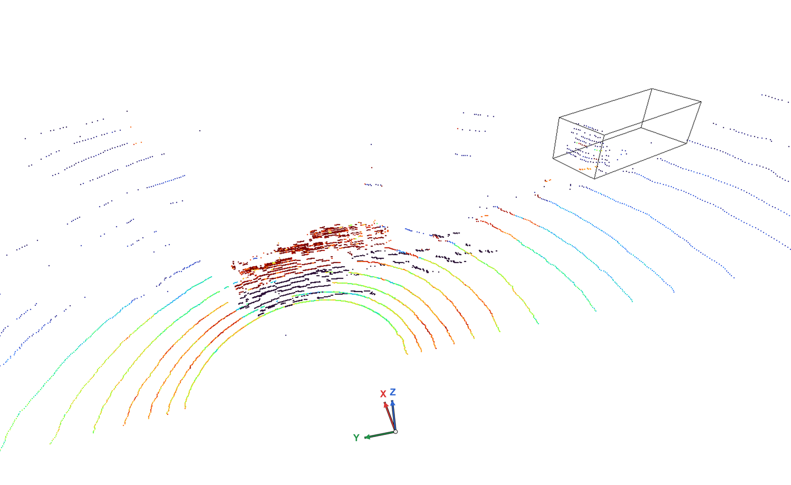</a></td>
  </tr>
</table>

## Installation

Requires Linux, Python 3.10, GCC, and Make. Physical simulation runs on CPU. Training requires an NVIDIA GPU; batch intensity inference automatically selects CUDA or CPU.

### 1. Create the environment

```bash
conda create -n lidardustsim python=3.10 -y
conda activate lidardustsim
python -m pip install --upgrade pip
```

On Ubuntu/Debian, install the compilation tools:

```bash
sudo apt-get update
sudo apt-get install -y build-essential
```

### 2. Install dependencies

Check GPU access and install PyTorch with the CUDA 11.8 runtime:

```bash
nvidia-smi

python -m pip install torch==2.1.0 torchvision==0.16.0 \
  --index-url https://download.pytorch.org/whl/cu118
```

Install the remaining dependencies:

```bash
python -m pip install \
  numpy==1.26.4 scipy==1.13.1 \
  opencv-python==4.11.0.86 Pillow==11.3.0 h5py==3.11.0 \
  matplotlib==3.10.3 tqdm==4.67.1 tensorboard==2.14.0

python -m pip check
```

### 3. Compile the Mie scattering library

Run from the repository root:

```bash
make -C ours/lidar_dust_LidarDustX/pylisa mie_so OS_OPTION=linux
```

This generates `ours/lidar_dust_LidarDustX/pylisa/mie.so`.

### 4. Verify the installation

```bash
PYTHONPATH="$PWD/ours/lidar_dust_LidarDustX" python - <<'PY'
import cv2
import h5py
import numpy
import scipy
import torch
import torchvision
from torch.utils.tensorboard import SummaryWriter
from pylisa.lisa_dust import LisaDust

print("PyTorch:", torch.__version__)
print("CUDA runtime:", torch.version.cuda)
print("CUDA available:", torch.cuda.is_available())

LisaDust()
print("Dependencies and Mie library: OK")
PY
```

## Data Preparation

### 1. LiDARDustX Dataset

Download the public LiDARDustX dataset from its official source. The dataset provides real LiDAR point clouds for scene construction and reflectance-intensity model training. Prepare the data separately for each LiDAR sensor.

### 2. CGNS Dust Fields

The physical simulation uses CGNS dust-field files generated by our CFD-DPM simulations. Organize the files as follows:

```text
fluent_cgns/
├── case_01/
│   ├── frame_0001.cgns
│   └── frame_0002.cgns
└── case_02/
    └── frame_0001.cgns
```

Each subdirectory corresponds to a simulation case, and each `.cgns` file contains the dust field for one simulation frame.

## Evaluation and Results

### Quantitative Results

Generation quality is evaluated on six LiDAR sensors using XYZI-FPD, XYZI-JSD, XYZI-MMD, and XYZI-FRD. Models are trained separately for each sensor. Lower values indicate smaller discrepancies between generated and real point clouds.

| Sensor | FPD ↓ | JSD ↓ | MMD ↓ | FRD ↓ |
| --- | ---: | ---: | ---: | ---: |
| CB64S1 | 5.9266 | 0.0262 | 32.0331 | 7.1634 |
| LS128S2 | 14.4914 | 0.0460 | 13.7415 | 1.4139 |
| Falcon K1 | 13.0136 | 0.0157 | 4.7686 | 3.9106 |
| Falcon K3 | 60.0780 | 0.0495 | 4.3634 | 6.3069 |
| M1 | 4.8753 | 0.0334 | 7.0504 | 1.1502 |
| Ouster 2 | 18.1766 | 0.0104 | 100.7929 | 3.0084 |

FPD, JSD, MMD, and FRD denote their XYZI variants. MMD is reported as $10^4 \times \mathrm{MMD}^2$, following Table 1 of the paper.

LiDARDustSim achieves the lowest discrepancies among the compared methods across all six sensors and four metrics.

### Qualitative Results

Qualitative comparisons across six LiDAR sensors are presented in Figs. 6–11 of the paper. LiDARDustSim preserves sensor-specific scanning structures and reproduces dust characteristics such as local aggregation, directional dispersion, and spatial coverage. Compared with the baseline methods, the generated point clouds exhibit spatial distributions more consistent with real dust observations.

Comparisons for all six LiDAR sensors are shown below.

**CB64S1 — Fig. 6**

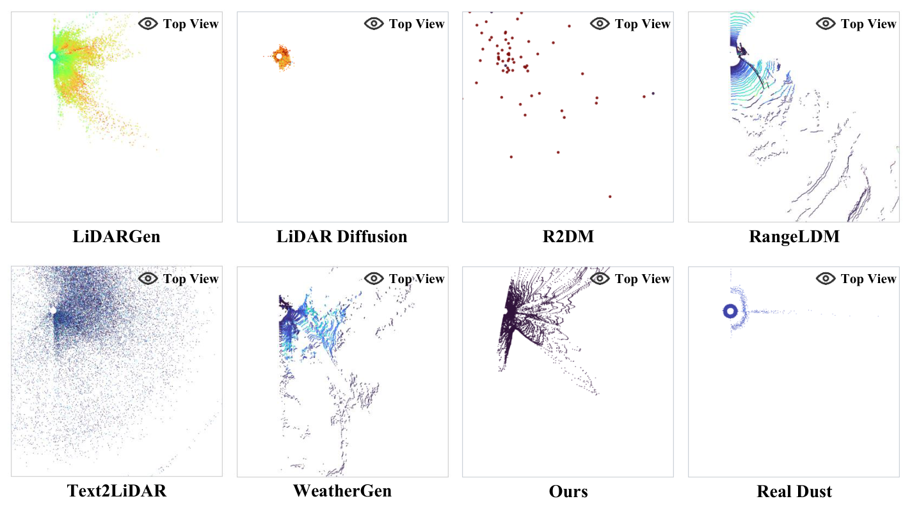

**LS128S2 — Fig. 7**

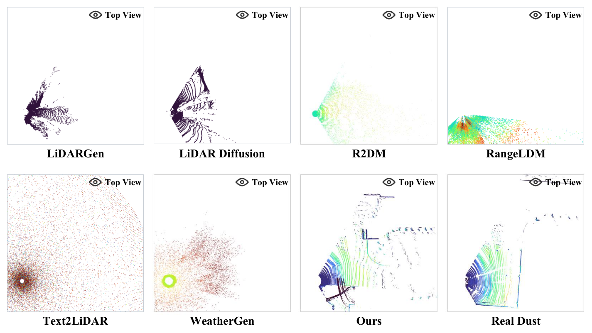

**Falcon K1 — Fig. 8**

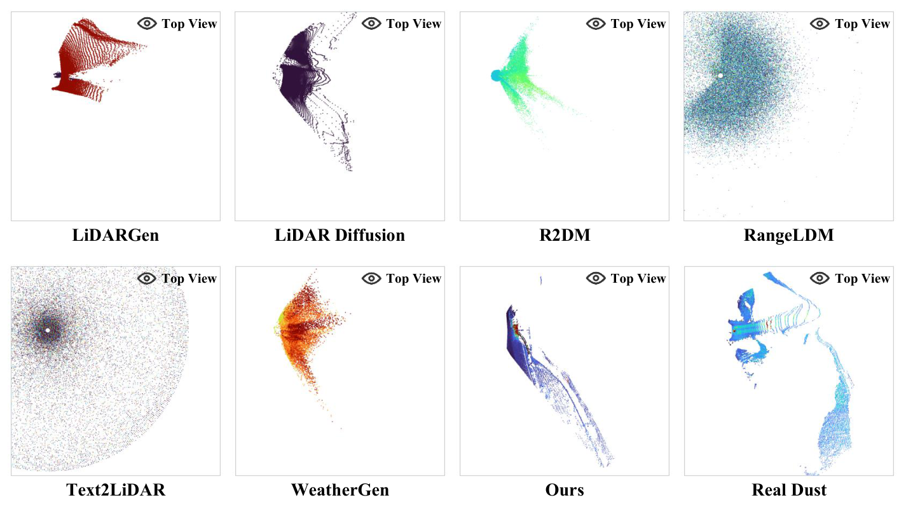

**Falcon K3 — Fig. 9**

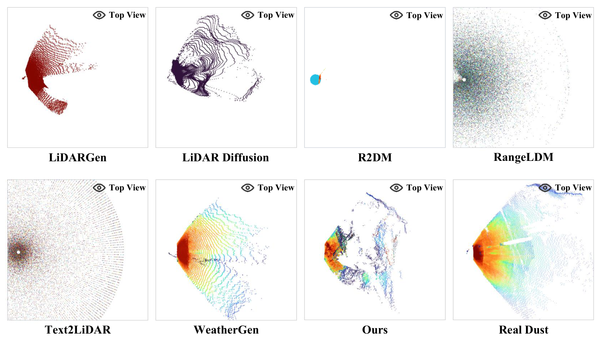

**M1 — Fig. 10**

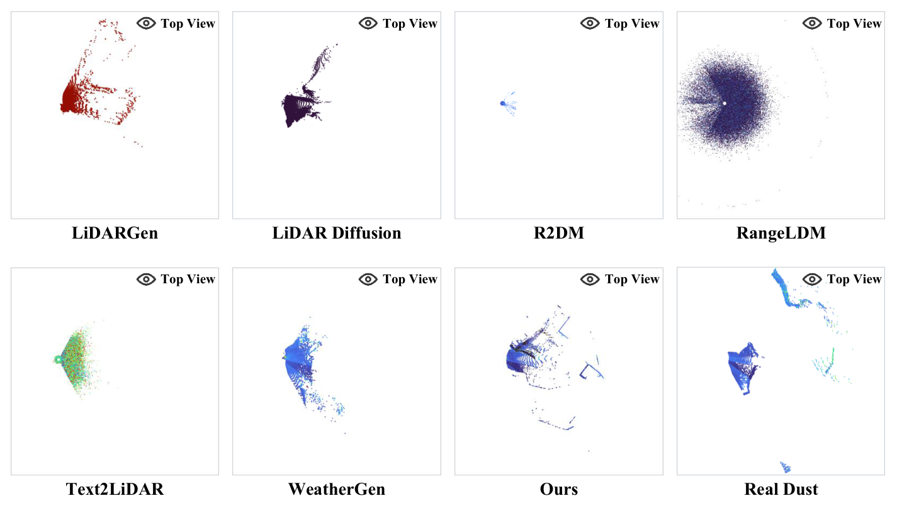

**Ouster 2 — Fig. 11**

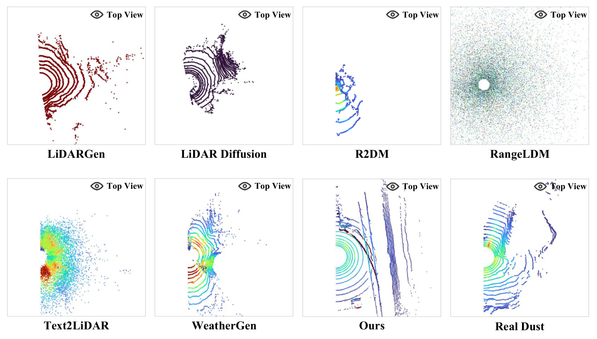

### Downstream 3D Object Detection

Generated data are evaluated using PointPillars within OpenPCDet for Car detection. Compared with repeating original training samples at the same dataset size, generated dust variations provide detection benefits on most sensors. Improvements depend on the sensor and augmentation scale.

**Car BEV AP and Car 3D AP across six sensors — Fig. 12**

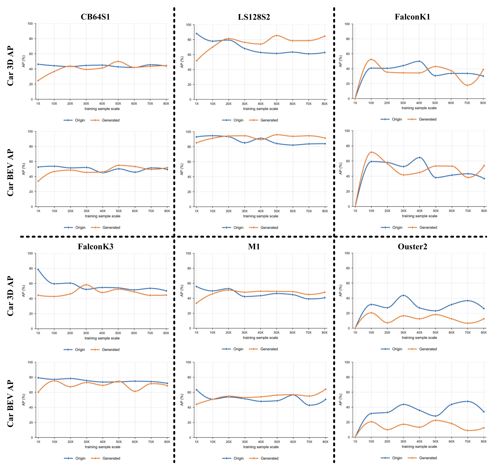

Origin repeats existing training samples, while Generated introduces new dust variations. Both schemes use the same number of training samples at each scale.

## Acknowledgments

We thank the authors of [LiDARDustX](https://github.com/vincentweikey/LiDARDustX) for making their dataset publicly available. We also thank the authors of [LISA](https://github.com/velatkilic/LISA) ([paper](https://arxiv.org/abs/2107.07004)) for releasing their physics-based LiDAR augmentation method and implementation.
